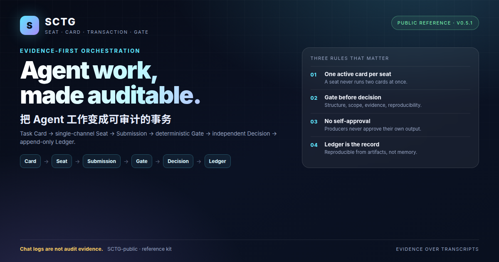

[English](README.md) | **简体中文**

# SCTG

**Seat–Card–Transaction–Gate** — 面向 AI 编程代理的证据优先编排。

SCTG 把 Agent 的工作拆成显式、可审计的单元：任务卡定义范围，单个 seat 同一时刻只执行一张卡，Gate 校验提交，独立 MAIN 审批授权不可逆动作，append-only ledger 记录真实发生的事。

大多数 Agent 工作流相信聊天记录。SCTG 相信证据。

- 聊天记录不是审计证据。
- 自己批准自己不是 Review。
- 静默重试会掩盖失败。
- 一次运行应该能从产物复现，而不是靠记忆。

SCTG 不是另一个 Agent 框架或模型。它是一套**控制模式 + 小型参考实现**，可以跑在 OpenRig、OpenCode 或普通 shell 之上。

## 总览



## 核心模型

```text
Task Card
  -> 单线 seat
  -> Submission
  -> 确定性 Gate
  -> 独立 MAIN Decision（需要时）
  -> append-only Ledger
```

三条规则比工具更重要：

1. **每个 seat 同一时刻只有一张 active card。**
2. **Host driver 不写 GateResult，也不写 seat 的产品内容。**
3. **生产者不批准自己的输出。** 不可逆动作需要独立 MAIN 审批。

## 仓库内容

```text
docs/                 概念、协议、架构、经验、来源
docs/cases/           来自真实参考运行的公开案例
docs/quickstart.md    英文快速开始
docs/quickstart.zh-CN.md 中文快速开始
docs/environment.md   支持环境与依赖
docs/reproducibility.md 确定性/非确定性说明
docs/limitations.md   SCTG 不证明什么
docs/security-model.md 信任边界与命令执行
docs/mode-policy.md  Shadow / Lite / Full
docs/decision-model.md 请求 -> 独立审批 -> replay
docs/ledger.md       append-only 事件与验收
docs/versioning.md   版本与发布
docs/faq.md          常见问题
docs/glossary.md     术语
AGENTS.md            AI Agent 工作规则
kit/                  参考 host runner、gates、submission schema
examples/             最小任务卡 + 可运行端到端 demo
tests/                公共仓库 smoke tests
scripts/check_repo.py 卫生、链接、secret 模式检查
Makefile              check / test / demo / clean
.github/workflows/ci.yml push / PR 自动检查
```

## 案例

- [十张卡，一个事务层](docs/cases/01-ten-card-shadow-pilot.md)：Gate 全绿，仍可能有语义错误。
- [从 PARTIAL 到 PASS](docs/cases/02-stage-2-governance.md)：保留历史 PARTIAL，用补救轮和重审赚 PASS。
- [Lite、adapter 与两个 seat](docs/cases/03-stage-2.5-lite-multi-seat.md)：Lite 5 卡、独立 join、真实 CLI 对齐，以及“单线是每 seat 单卡”。

## 示例

- [`examples/minimal-run`](examples/minimal-run/run_demo.py) — 单卡四 gate。
- [`examples/multi-card`](examples/multi-card/run_demo.py) — 三卡串行。
- [`examples/decision`](examples/decision/run_demo.py) — 请求、审批、replay。
- [`examples/rollback`](examples/rollback/run_demo.py) — Shadow → Lite → Shadow。
- [`examples/two-seat-handoff`](examples/two-seat-handoff/run_demo.py) — producer + reviewer join。
## 快速开始

```bash
python3 -m venv .venv
. .venv/bin/activate
pip install -r requirements.txt
pip install pytest

make check
make test
make demo
```

`make demo` 会跑完一次完整事务：card -> submission -> 四个 gate -> ledger。  
详细步骤见 [`docs/quickstart.zh-CN.md`](docs/quickstart.zh-CN.md)。

## 可复现性

SCTG 不宣称模型输出可复现。它宣称**事务可复现**：card、submission、gate result、evidence hash、decision record 可以重放和审计。

详见 [`docs/reproducibility.md`](docs/reproducibility.md)。CI 每次 push 都会跑 `make check`、`make test`、`make demo`。

## 基准对比

- [原始 Agent vs SCTG：同任务对比](docs/benchmarks/pilot-2026-11.md) —
  小任务上 SCTG 增加 25–97% 的墙钟时间，但额外产生 card/submission/gate/ledger 审计产物。

## 状态

本仓库是提炼后的公开参考，不是内部 run 数据转储。它来自一次成功的 Stage-2.5 参考运行：

- Lite pilot：5 卡，独立 review，rollback drill；
- 两个 seat 的 handoff + join；
- adapter v0：真实只读 CLI 对齐 + 本地幂等 ledger；
- 最终退出审计：24/24 PASS；Full 模式有意保持关闭。

本仓库**不宣称生产可用**，也**不宣称 Full 模式已经验证**。

## 设计原则

- 证据优先于 transcript。
- Gate 检查结构、范围、证据、可复算，不检查语义正确。
- 语义 Review 与 Gate 分离。
- 模式切换必须有明确 scope、expiry 和 rollback 的 Decision。
- 范围冲突不能靠“先跑了再说”解决。

## 项目

- [贡献指南](CONTRIBUTING.md)
- [安全](SECURITY.md)
- [变更日志](CHANGELOG.md)
- [版本说明](docs/versioning.md)
- [常见问题](docs/faq.md)
- [术语](docs/glossary.md)

## 许可

Apache License 2.0。见 [`LICENSE`](LICENSE) 与 [`NOTICE`](NOTICE)。
